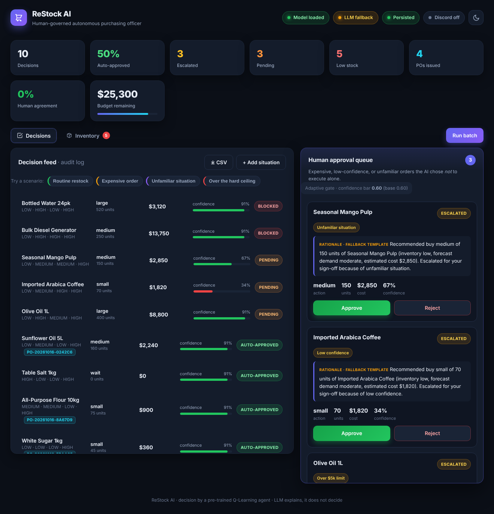
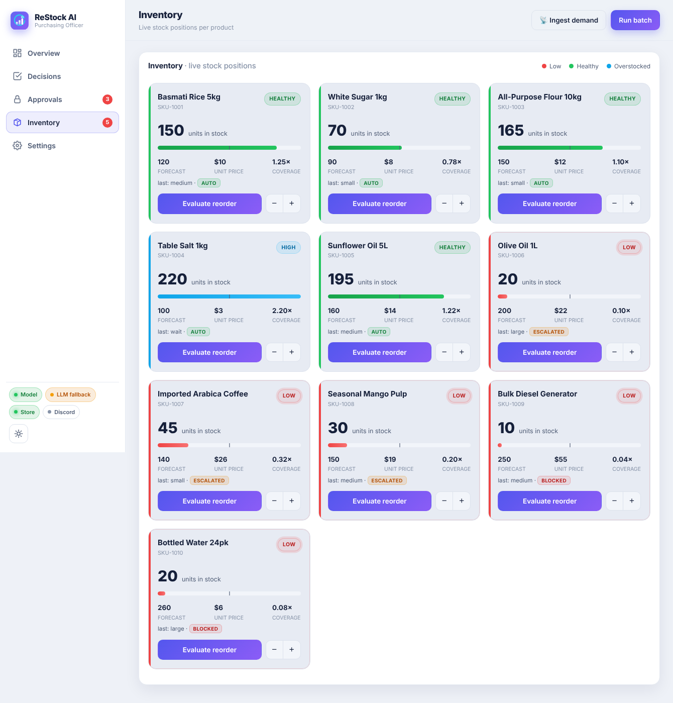
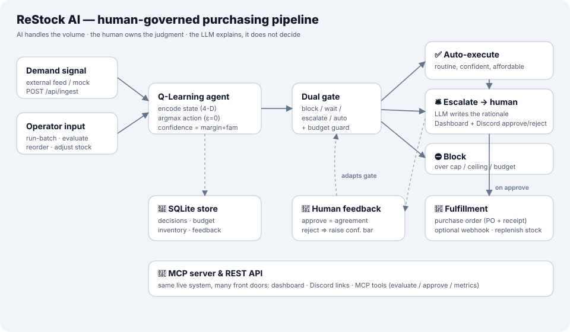

<div align="center">

# 🛒 ReStock AI

### A Human-Governed Autonomous Purchasing Officer

*The AI handles the volume. The human owns the judgment.*


<em>Theme — <strong>Human + AI: Better Together</strong> · built for Agentika 2.0 (NaSCon 2026)</em>

</div>

---

A pre-trained **Q-Learning** agent decides how much to reorder for every product. It
**auto-executes the routine, low-risk orders**, and **escalates the expensive, uncertain
or unfamiliar ones to a human** for one-click approval. An LLM writes the plain-English
rationale for each escalation — it *explains*, it does not *decide*.

<div align="center">

### 🌙 Dark &nbsp;·&nbsp; ☀️ Light — one-click theme toggle




</div>

---

## ✨ Highlights

| | Feature | What it does |
|---|---|---|
| 🧠 | **Q-Learning agent** | Encodes each situation into a 4-D state and picks the reorder action (inference only) |
| 🚦 | **Dual safety gate** | Routes every decision: **auto-execute**, **escalate to a human**, or **block** |
| 💬 | **Discord approvals** | Escalations are pushed to Discord/Slack with **one-click Approve / Reject links** |
| 🧾 | **Real fulfillment** | Executed orders raise a **purchase order** (PO number + receipt), optionally POSTed downstream |
| 💾 | **Persistence** | SQLite keeps decisions, budget and feedback alive across a redeploy |
| 🔁 | **Adaptive gate** | Human rejections *raise the confidence bar* — the gate learns to be more cautious (governance only) |
| 📡 | **Reactive ingestion** | A demand signal (external feed or mock) auto-triggers re-evaluation — new demand → decision |
| 🔌 | **MCP server** | Drive the live service from any MCP client (e.g. Claude Desktop) |
| 🎨 | **Polished dashboard** | Light/dark themes, scenario presets, CSV audit export, live counters & toasts |
| 🧪 | **Tested** | `pytest` suite covering the gate, confidence math, persistence and the API |

---

## 🚀 Quick start (local)

```bash
python -m venv .venv
source .venv/bin/activate         # Windows: .venv\Scripts\activate

pip install -r requirements.txt
uvicorn app.main:app --reload --port 8000
```

Open **http://127.0.0.1:8000**, hit **Run batch**, and try the **Try a scenario** buttons.

> No API key needed to run — without one, the app uses a deterministic templated
> rationale and still works end to end. For live LLM explanations, copy
> `.env.example` → `.env` and set `LLM_API_KEY` (and `LLM_PROVIDER`).

---

## ⚙️ How it works

<div align="center">

</div>

```
demand signal / operator input → encode state (LOW/MED/HIGH ×4) → Q-table argmax (ε=0)
          → quantity + cost + confidence → ⟨ DUAL GATE ⟩
          → ✅ AUTO-EXECUTE   |   🛎️ ESCALATE (LLM rationale → human)   |   ⛔ BLOCK
          → purchase order · dashboard · audit log · Discord
```

**The dual gate** (first match wins):

1. ⛔ **BLOCK** — `qty > MAX_ORDER_QTY`, `cost > HARD_LIMIT`, or `cost > remaining budget`
2. ⏸️ **WAIT** actions always auto-approve (safe no-op)
3. 🛎️ **ESCALATE** — `cost > AUTO_LIMIT` · `confidence < CONF_THRESHOLD` · `visits < MIN_VISITS_FAMILIAR`
4. ✅ otherwise **AUTO-APPROVE**

**Confidence** `= 0.7 · margin + 0.3 · familiarity` — *margin* is how decisively the agent
preferred its action; *familiarity* is how well-trained that state is. The human-feedback
loop nudges the effective `CONF_THRESHOLD` up after rejections and back down after approvals.

---

## 🖥️ The dashboard

Two live-polling tabs with animated counters, toasts and a light/dark toggle:

- **Decisions** — the audit-log feed + the human approval queue (the hero panel), scenario
  presets, and a one-click CSV export.
- **Inventory** — live stock cards with a stock bar, coverage, LOW/HEALTHY/HIGH status
  (low-stock cards pulse) and working controls: *Evaluate reorder* and a ± stock stepper.
  Executed orders **replenish stock** in real time.

---

## 🔌 Integrations *(all optional — the app runs fully without any of them)*

Set these as environment variables on your host (never commit real values — see `.env.example`):

| Variable | Effect |
|---|---|
| `DB_PATH` | SQLite file for persistence (empty = pure in-memory MVP mode) |
| `NOTIFY_DISCORD_WEBHOOK_URL` | Push escalations to Discord with Approve/Reject links |
| `PURCHASE_ORDER_WEBHOOK_URL` | POST a PO receipt downstream on every executed order |
| `PUBLIC_BASE_URL` | Your deployed URL — makes the Discord Approve/Reject links absolute |

> Every integration **degrades gracefully**: a missing or failing webhook never breaks a
> decision, voids an order, or crashes the service.

### Model Context Protocol (MCP)

`mcp_server.py` exposes the live service as MCP tools (`evaluate_reorder`, `list_pending`,
`approve_order`, `reject_order`, `get_metrics`, `get_inventory`, `run_batch`). It talks to
the running API over HTTP, so an approval through MCP affects the **same** system as the
dashboard and the Discord links. It is deliberately kept out of `requirements.txt` so it
can never jeopardise the web deployment.

```bash
pip install -r requirements-mcp.txt
RESTOCK_API_URL=https://your-app.example python mcp_server.py
```

---

## 📡 API (prefix `/api`)

| Method | Path | Purpose |
|---|---|---|
| `GET`  | `/api/health` | Liveness check (independent of model/LLM) |
| `POST` | `/api/run-batch` | Run the agent over the seed dataset (resets state first) |
| `POST` | `/api/evaluate` | Evaluate one manually-entered situation |
| `POST` | `/api/ingest` | Pull a demand signal and auto-re-evaluate the affected products |
| `GET`  | `/api/decisions` | All decision records (`?status=` filter) |
| `GET`  | `/api/pending` | Only pending escalations |
| `POST` | `/api/decisions/{id}/approve` · `/reject` | Human resolves an escalated order |
| `GET`  | `/api/metrics` | Dashboard summary (auto %, budget, POs, agreement rate …) |
| `GET`  | `/api/inventory` | Live per-product stock positions + status |
| `POST` | `/api/inventory/{id}/reorder` · `/adjust` | Evaluate at current stock · manual correction |
| `GET`  | `/api/decisions.csv` | Download the full audit log as CSV |
| `GET`  | `/api/presets` | Demo scenario presets (auto / escalate / block) |
| `GET`  | `/a/{id}` · `/r/{id}` | One-click Approve / Reject (used by Discord links) |
| `GET`  | `/api/model-status` | Model / LLM / integrations / constants (diagnostics) |

---

## 🗂️ Project layout

```
app/
  main.py      FastAPI routes, lifespan, static dashboard
  agent.py     Q-Learning agent (inference only) + confidence
  gate.py      the dual safety gate
  llm.py       LLM rationale layer (graceful fallback)
  store.py     in-memory store, mirrored to SQLite + feedback loop
  db.py        SQLite persistence (survives a redeploy)
  fulfill.py   purchase-order fulfillment (PO + optional webhook)
  notify.py    Discord/Slack escalation notifications + approve links
  signals.py   demand-signal ingestion (external feed or mock) → reactive loop
model/         q_table.json + config.json  (pre-trained artifacts; inference only)
data/          inventory_seed.csv          (demo situations: all three routes)
static/        index.html, app.js, styles.css  (single-page dashboard, themeable)
tests/         pytest suite (gate, agent, API, persistence, feedback)
mcp_server.py  MCP server (separate process; see requirements-mcp.txt)
docs/          architecture diagram + dashboard screenshots
```

---

## 🧪 Honest notes on the "model"

We'd rather you hear this from us than find it in the code:

- **The Q-table is a synthesised, explainable policy — not a trained one.** This build
  ships no training notebook; `model/q_table.json` + `model/config.json` were generated by
  a deterministic heuristic (`scripts/generate_model.py`) that covers all 81 discretised
  states. The app does **inference only** and never modifies the table. Drop in a
  notebook-exported Q-table with the same schema (`meta.actions`, `states[key][action]`,
  optional `_visits`) and everything works unchanged — the policy is a **pluggable artifact**.
- **The feedback loop is adaptive *governance*, not retraining.** Human rejections raise the
  effective confidence bar so the gate escalates sooner; approvals relax it back. The
  learned Q-values are never touched.
- **The LLM explains, it never decides.** Every purchasing choice is the Q-table's; the LLM
  only writes the human-readable rationale for an escalation, with a deterministic fallback.

### Run the tests

```bash
pip install -r requirements-dev.txt
pytest
```

**Design decisions resolved from the SRS**
- **Budget** is a single global pool from `config.monthly_budget`, decremented as orders execute.
- **`WAIT` always auto-approves**, even in an unfamiliar state (explicit gate short-circuit).
- **`run-batch` is idempotent** — it resets decisions, budget and inventory, so the presenter
  can click it repeatedly during the demo without double-spending.

---

## ☁️ Deployment

One repo, one service. A `Dockerfile` is included and platforms that inject `$PORT` are
handled. Set your environment variables in the platform dashboard — never commit `.env`.

**Verify after deploy:** the public URL serves the dashboard and `/api/health` returns
`{"status":"ok"}`. Then set `PUBLIC_BASE_URL` to that URL so the Discord Approve/Reject
links resolve.

<div align="center">
<sub>Decision by a pre-trained Q-Learning agent · the LLM explains, it does not decide.</sub>
</div>
